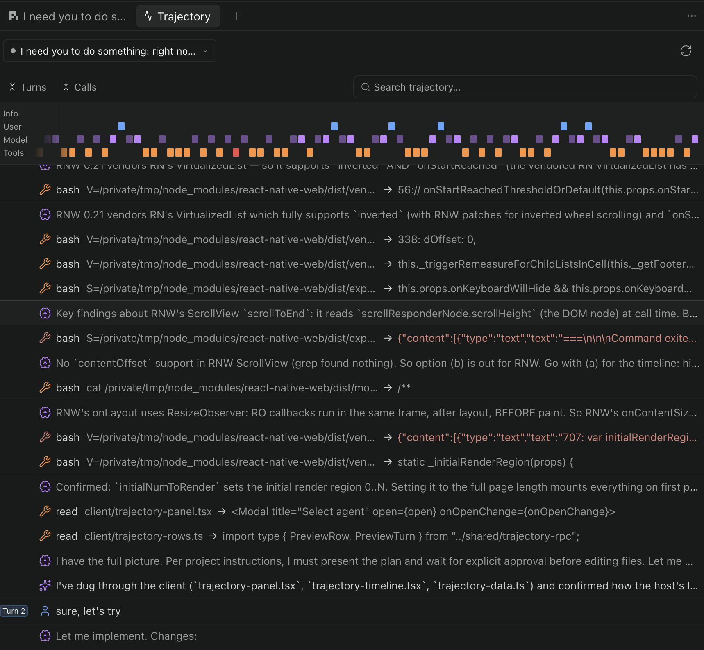

# paseo-trajectory

A Paseo plugin that shows an agent's activity as a
turn-aware trajectory ledger. Inspired by the trajectory view of DeepSeek's
harness, it builds entirely on the data exposed by the Paseo timeline.



## Install

```sh
paseo plugin install github.com/AlexCovizzi/paseo-trajectory
```

See the Paseo documentation for adding plugins from a Git repository.

## Disclaimer

- Fully vibe coded.
- It shows less data than DeepSeek's harness: Paseo doesn't expose that
  data on the timeline yet.
